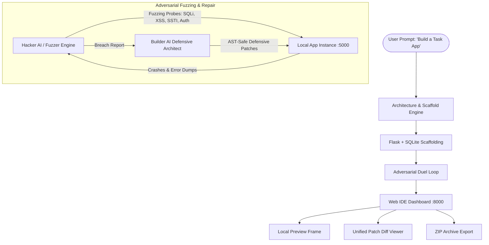

# AEGIS Engineering Roadmap

## Overview
AEGIS is an experimental adversarial software development agent architecture. It pairs a **Builder AI** (generative code synthesizer) with an automated **Hacker AI** (red-team fuzzer and probe suite) to construct, test, and harden small web applications in a local developer loop.

---

## Planned Development Phases

### Phase 1: Robust Fuzzing & Verified Self-Defense Engine
- **Fuzzer Coverage**:
  - Boundary conditions and unhandled 404 route detection.
  - Parameter tampering and empty payload handling.
  - Basic injection heuristics (reflected script tags, template evaluation markers).
  - Authentication flow robustness and session state checks.
- **Defensive Repair & Verification**:
  - AST-checked defensive patching using Python's `ast` module.
  - Mandatory re-testing of reported breach vectors before marking vulnerabilities resolved.
  - Realistic and truthful security health score calculation based on verified patches vs total breaches.

### Phase 2: Web IDE & Real-Time Duel Telemetry
- **Visual Code Review**:
  - Side-by-side and unified diff rendering of applied security patches.
  - Real-time event streaming over WebSockets.
- **Workspace Security**:
  - Strict path sanitization (`safe_join`) preventing directory traversal across all filesystem endpoints.
  - Secure defaults for secret keys, session tokens, and database connections.
- **Export & Portability**:
  - Clean archive export (`.zip`) excluding environment configurations, virtual environments, and caches.

### Phase 3: Multi-Provider LLM Integration
- **Model Orchestration**:
  - Native support for local Ollama instances (`qwen2.5-coder:7b`, `deepseek-coder`).
  - Cloud provider integration via standardized APIs (Google Gemini, OpenAI GPT-4o, Anthropic Claude).
  - Graceful degradation with clear user feedback when API keys are not configured.

---

## Technical Security Notes
- The fuzzer relies on heuristic pattern matching and crash detection. It does not replace an accredited manual security audit or comprehensive static/dynamic analysis tools.
- Generated code runs directly on the local machine during previews. Always execute untrusted prompts inside an isolated container or virtual machine.
