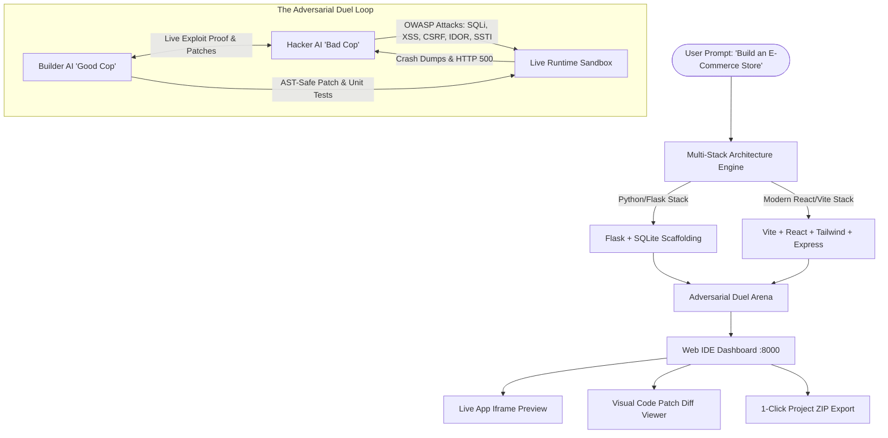

# Master Startup Execution Plan: AEGIS Adversarial Dual-AI Platform

**Objective**: Scale AEGIS from a functional prototype into a commercial-grade, venture-ready autonomous software engineering platform that beats Lovable, Bolt.new, and Cursor in both application security and developer experience.

---

## Architecture Overview

---

## Sequence of Execution

### Phase 1: Option A — Supercharge the Hacker & Builder Duel Engine
> **Goal**: Turn the Hacker AI into a world-class autonomous red-team penetration tester and make the Builder AI's auto-patching resilient and AST-verified.

1. **Expand OWASP Top 10 Red-Team Exploits ([`agent/hacker_suite_generator.py`](file:///e:/Moon/AI-Autonomous-Software-Agent/agent/hacker_suite_generator.py))**:
   - **Broken Object Level Authorization (BOLA/IDOR)**: Test tampering with user/resource IDs in routes (e.g. `GET /tasks/1` vs `GET /tasks/2` with unauthorized session cookies).
   - **Server-Side Template Injection (SSTI)**: Inject Jinja/EJS payloads (`{{7*7}}`, `${7*7}`) into search and input fields to detect remote code execution.
   - **Cross-Site Request Forgery (CSRF)**: Test POST endpoints for missing CSRF tokens or missing `SameSite` cookie protections.
   - **Brute Force & Rate-Limiting Failure**: Bombard auth endpoints (`/login`, `/register`) with rapid bursts to test whether rate-limiting or lockouts exist.
   - **Privilege Escalation & Session Tampering**: Inject malformed session cookies and manipulated JSON tokens.

2. **Upgrade Builder AI Self-Defense & Verification ([`agent/adversarial_duel.py`](file:///e:/Moon/AI-Autonomous-Software-Agent/agent/adversarial_duel.py))**:
   - **Targeted AST Patching**: Builder AI generates surgical patch functions instead of rewriting full files blindly, verifying python syntax with `ast.parse` before writing to disk.
   - **Automated Regression Verification**: After applying a patch, the Builder automatically runs a sanity check to ensure the target app still responds to legitimate requests and didn't crash.
   - **Dual-AI Defense Scorecard**: Output a standardized JSON security audit report (`security_audit.json`) containing total probes launched, vulnerabilities detected, patches applied, and final Shield Health score.

---

### Phase 2: Option B — Startup-Grade Web IDE Dashboard & Live Streaming
> **Goal**: Elevate the UI/UX at `http://127.0.0.1:8000` to rival Lovable.dev and Bolt.new with live visual patch diffs, project export, and seamless duel telemetry.

1. **Visual Patch Diffing View ([`web/index.html`](file:///e:/Moon/AI-Autonomous-Software-Agent/web/index.html) & [`web/app.js`](file:///e:/Moon/AI-Autonomous-Software-Agent/web/app.js))**:
   - Add a split-diff / unified-diff viewer in the code editor panel.
   - When the Builder patches a security breach, highlight exact deleted lines (red) and newly inserted defensive code (green) in real time.

2. **1-Click Project ZIP Export ([`ide_server.py`](file:///e:/Moon/AI-Autonomous-Software-Agent/ide_server.py))**:
   - Add `/api/export-zip` endpoint that packages the fortified codebase (excluding `.venv` and cache) into a clean, downloadable `.zip` archive.
   - Add an **"Export Code 📦"** button to the Web IDE header so users can immediately download and deploy their apps.

3. **Chaos Console & Shield Meter Polish**:
   - Add interactive exploit logs to the Chaos Console, displaying the exact HTTP response code, headers, and exploit payload fired.
   - Add animated visual badges for each security tier (Sanity $\rightarrow$ Auth $\rightarrow$ Injections $\rightarrow$ Logic).

---

### Phase 3: Option C — Support React / Vite Full-Stack Projects
> **Goal**: Match Lovable and Bolt.new by allowing the agent to generate modern JavaScript/TypeScript (Vite + React + Tailwind + Node/Express) alongside Python/Flask.

1. **Multi-Stack Template Engine ([`agent/main.py`](file:///e:/Moon/AI-Autonomous-Software-Agent/agent/main.py))**:
   - Add stack detection to the Requirement Analyzer (`analyze_requirements`): If the user asks for a React/Tailwind/Next app, generate a Vite/React + Express structure.
   - Provide pre-built modern scaffold templates for React + Tailwind components.

2. **Universal Red-Team Scanner**:
   - Update `scan_flask_endpoints` into a **Universal Endpoint Scanner** that parses both Flask/FastAPI routes and Express/Node route handlers (`app.get`, `router.post`).

3. **Multi-Port Live Preview in Web IDE ([`ide_server.py`](file:///e:/Moon/AI-Autonomous-Software-Agent/ide_server.py))**:
   - Add runtime detection: If the project is Python, serve on port `5000`; if the project is Node/Vite, run `npm run dev` and proxy the preview to port `5173`.

---

## Deliverables & Milestones

| Milestone | Deliverables | Verification Criteria |
| :--- | :--- | :--- |
| **M1 (Option A)** | Advanced OWASP vectors in `hacker_suite_generator.py` + AST-safe patching in `adversarial_duel.py` | Standalone duel successfully finds IDOR, SSTI, and CSRF vulnerabilities, patches them cleanly, and emits audit report. |
| **M2 (Option B)** | Visual diff viewer, 1-click ZIP export, real-time Chaos Console telemetry in Web IDE | User can trigger a duel, watch lines change in green/red diffs, and download a hardened ZIP archive. |
| **M3 (Option C)** | Vite/React/Tailwind scaffold engine + Universal Scanner + dual runtime preview | Prompting for a React app generates full Vite + React files and previews in the iframe. |

---

## Feedback & Confirmation
Please click **Proceed** or review the plan above to initiate execution starting immediately with **Phase 1 (Option A)**.
